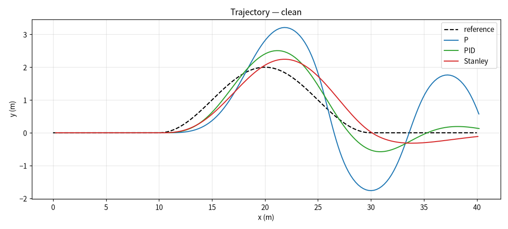
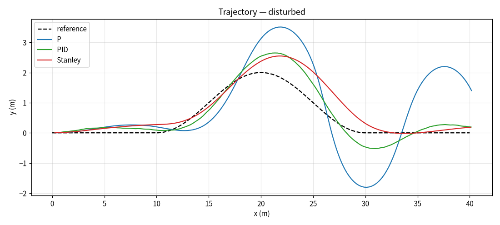
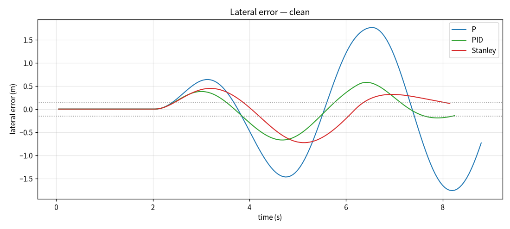
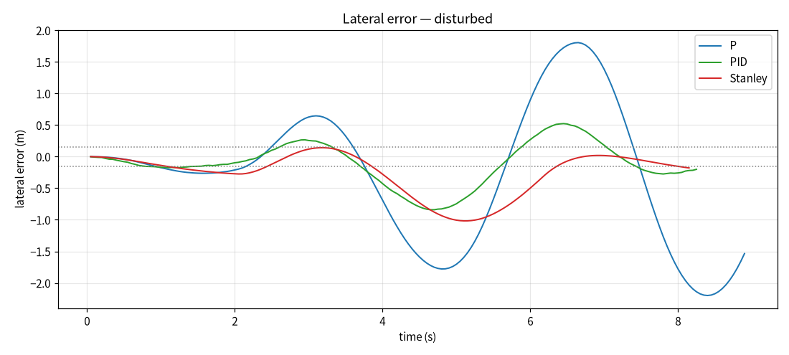
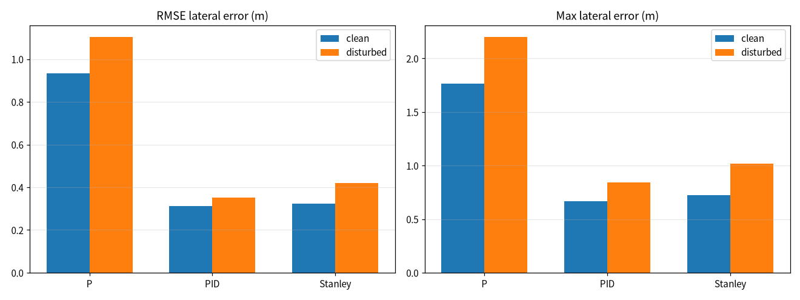
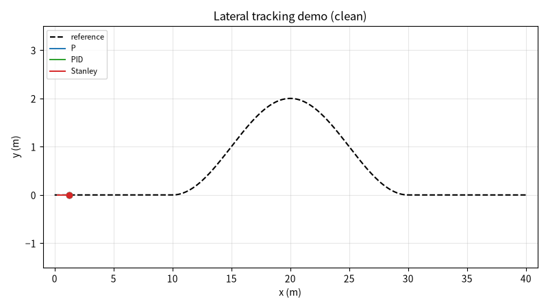

# 地面小车横向路径跟踪控制器对比评测

本文介绍一个纯 Python（numpy + matplotlib + Pillow）实现的横向控制器对比评测模块。模块以独轮（阿克曼等效）运动学模型为被控对象，小车以恒定纵向速度沿一条双移线（lane change）参考路径行驶；在**同一参考路径、同一初始位姿**下依次接入 P 比例、PID、Stanley 三种横向控制器，分别在 `clean`（无扰动）和 `disturbed`（定位噪声 + 侧风偏航扰动）两组条件下完成跟随，对每段轨迹统计最大横向误差、横向误差均方根（RMSE）、收敛时间、最大控制量四个指标，量化不同控制器在理想工况与扰动工况下的路径跟随能力；仿真结束后自动合成跟随过程的演示动图。

## 1. 运行环境

| 项目 | 版本 / 说明 |
| --- | --- |
| 操作系统 | Windows 10 / 11（Linux 亦可，脚本后台出图，无需图形界面） |
| 仿真平台 | 纯 Python 运动学仿真，不依赖 ROS / Gazebo / CARLA |
| Python | 3.10 ~ 3.12 |
| 依赖 | `numpy`、`matplotlib`、`Pillow` |

### 1.1 安装依赖

1. 创建并激活虚拟环境（与系统中其他 Python 版本隔离）：

   ```bash
   python -m venv ctrl_env
   # Windows: ctrl_env\Scripts\activate
   # Linux:  source ctrl_env/bin/activate
   ```

2. 安装依赖：

   ```bash
   pip install numpy matplotlib Pillow
   ```

### 1.2 验证环境

保持虚拟环境已激活，在源码目录执行：

```bash
python -c "import numpy, matplotlib, PIL; print('dependencies ok')"
```

输出 `dependencies ok` 即表示依赖安装完成。

## 2. 实验原理

### 2.1 参考路径与运动学模型

小车采用独轮运动学模型，纵向速度恒定为 `v = 5.0 m/s`，步长 `dt = 0.05 s`：

```
x += v·cos(θ)·dt
y += v·sin(θ)·dt
θ += ω·dt
```

参考路径为一段双移线：`x ∈ [10, 30] m` 内用正弦平方曲线把横向偏移从 0 过渡到 2 m，其余区间保持 0。控制器在每一步根据当前位姿对应的参考横向位置 `y_ref` 和参考航向 `θ_ref = atan(dy_ref/dx)` 计算横向误差 `e_y = y_ref − y` 与航向误差 `e_θ = θ_ref − θ`。

### 2.2 三种横向控制器

| 控制器 | 控制律 | 特点 |
| --- | --- | --- |
| `P` | `ω = Kp·e_y` | 仅横向误差比例反馈，结构最简单，无阻尼项，容易超调振荡 |
| `PID` | `ω = Kp·e_y + Ki·∫e_y dt + Kd·de_y/dt` | 积分消稳态偏差，微分抑制超调，参数整定后平稳 |
| `Stanley` | `δ = e_θ + atan2(k·e_y, v)`，`ω = v/L·tan(δ)` | 基于航向误差与横向偏差的几何反馈，控制量平缓，对偏差响应直接 |

### 2.3 扰动条件

- **定位噪声**：扰动工况下控制器拿到的横向测量值叠加高斯噪声，标准差 `0.06 m`；
- **侧风偏航**：扰动工况下每步叠加恒定偏航角速度 `0.12 rad/s`，模拟侧风把车头推离路径。

噪声序列使用固定随机种子生成，可复现。

### 2.4 评价指标

| 指标 | 定义 |
| --- | --- |
| 最大横向误差 `max_err` | 全程 `|e_y|` 的最大值（m），反映最坏跟随偏差 |
| 横向误差均方根 `rmse` | `√(mean(e_y²))`（m），反映全程平均跟随精度 |
| 收敛时间 `settle_time` | 横向误差最后一次越出 ±0.15 m 带宽的时刻（s），反映回到参考线的快慢 |
| 最大控制量 `max_steer` | 全程 `|ω|` 的最大值（rad/s），反映控制动作的剧烈程度 |

## 3. 代码结构

完整源码位于：[`src/ground/lateral_control_benchmark/main.py`](https://github.com/OpenHUTB/ros2/tree/master/src/ground/lateral_control_benchmark)

脚本为单文件入口 `main.py`，按执行顺序分为以下几个部分：

| 代码段 | 作用 |
| --- | --- |
| 仿真参数 | 步长、速度、轴距、路径终点、随机种子、扰动强度、收敛带宽等常量 |
| 参考路径 | `reference_path(x)` 返回给定纵向位置的参考横向位置与斜率 |
| 控制器类 | `PController` / `PIDController` / `StanleyController`，统一 `step(e_y, e_θ, v, dt)` 接口输出角速度 |
| 单段仿真 | `simulate()` 推进运动学模型，记录轨迹、误差、控制量，结束后计算四项指标 |
| 批量评测 | `evaluate()` 遍历控制器 × 工况组合，汇总指标表与轨迹 |
| 绘图 | 轨迹俯视图、误差曲线、指标分组柱状图、演示动图逐帧渲染 |
| 结果输出 | 写 `metrics.csv`，保存 PNG 与 GIF 到脚本同级 `results/` 目录 |

下面只解释三处关键实现，完整代码请直接查看 `src/` 下的源码。

**（1）统一控制器接口**

三种控制器暴露相同的 `step` 接口，便于在批量评测中互换：

```python
class StanleyController:
    def step(self, e_y, e_theta, v, dt):
        heading_term = e_theta
        cross_term = math.atan2(self.k * e_y, max(v, 0.1))
        delta = max(-0.6, min(0.6, heading_term + cross_term))
        return v / self.wheelbase * math.tan(delta)
```

**（2）运动学推进与扰动注入**

每步先取带噪声的横向测量值，再叠加侧风偏航，最后按独轮模型更新位姿：

```python
e_y = e_y_true + (rng.gauss(0.0, NOISE_STD) if disturbed else 0.0)
e_theta = theta_ref - theta
omega = controller.step(e_y, e_theta, V, DT)
if disturbed:
    theta += WIND_YAW_RATE * DT
theta += omega * DT
x += V * math.cos(theta) * DT
y += V * math.sin(theta) * DT
```

**（3）指标统计**

轨迹记录完成后，用误差序列计算最大偏差、RMSE，并按收敛带宽复核收敛时间：

```python
e_arr = np.array(records['e_y'])
max_err = float(np.max(np.abs(e_arr)))
rmse = float(np.sqrt(np.mean(e_arr ** 2)))
```

## 4. 运行步骤

1. 在已激活的 Python 虚拟环境中，进入源码目录运行入口脚本：

   ```bash
   cd src/ground/lateral_control_benchmark
   python main.py
   ```

2. 脚本依次完成 3 种控制器 × 2 组条件共 6 段仿真，每段把轨迹与误差写入结果目录；随后绘制轨迹俯视图、误差曲线和指标柱状图，并在 clean 工况下逐帧合成演示动图。

3. 运行结束后在 `results/` 目录得到：
   - `lateral_control_trajectory_clean.png` / `lateral_control_trajectory_disturbed.png`：两组条件轨迹俯视图
   - `lateral_control_error_clean.png` / `lateral_control_error_disturbed.png`：横向误差曲线
   - `lateral_control_metrics.png`：RMSE 与最大误差对比柱状图
   - `metrics.csv`：四指标数据表
   - `lateral_control_demo.gif`：clean 工况跟随演示动图

## 5. 实验结果

**实验设计说明**：6 段仿真使用同一条双移线参考路径、同一个初始位姿（`x=y=θ=0`），扰动工况仅改变测量噪声与侧风偏航，因此图中差异只来自控制器本身与扰动条件，排除了「起点或路径不同导致结果不可比」的干扰。

### 5.1 轨迹对比

clean 工况（无扰动）轨迹俯视图：



disturbed 工况（定位噪声 + 侧风）轨迹俯视图：



### 5.2 横向误差曲线

clean 工况横向误差随时间变化：



disturbed 工况横向误差随时间变化：



### 5.3 指标数据

同一路径同一初始位姿，各控制器取整段轨迹统计（固定随机种子）：

| 控制器 | 工况 | 最大误差 (m) | RMSE (m) | 收敛时间 (s) | 最大控制量 (rad/s) |
| --- | --- | --- | --- | --- | --- |
| P | clean | 1.764 | 0.933 | 8.80 | 1.200 |
| PID | clean | 0.669 | 0.311 | 8.20 | 0.756 |
| Stanley | clean | 0.726 | 0.323 | 7.95 | 0.547 |
| P | disturbed | 2.199 | 1.103 | 8.90 | 1.200 |
| PID | disturbed | 0.841 | 0.353 | 8.25 | 1.200 |
| Stanley | disturbed | 1.017 | 0.421 | 8.15 | 0.673 |

指标对比柱状图：



### 5.4 跟随演示动图

clean 工况下三种控制器沿双移线跟随的过程（蓝色 P、绿色 PID、红色 Stanley，虚线为参考路径）：



## 6. 结论

在同一路径、同一初始位姿下对比三种横向控制器，可以看到：

- **纯 P 控制跟随精度最差**：clean 工况 RMSE 已达 0.933 m，最大误差 1.764 m，轨迹出现明显超调与振荡；加入扰动后 RMSE 进一步升到 1.103 m，且控制量全程顶在 ±1.2 rad/s 限幅上，说明只有比例反馈、缺少阻尼和积分作用时，偏差一旦放大就难以收回。
- **PID 与 Stanley 明显更平稳**：两者 clean 工况 RMSE 都在 0.31~0.32 m 量级，约为纯 P 的三分之一；PID 依靠微分抑制超调，Stanley 依靠航向 + 横向几何反馈，轨迹都更贴近参考线。
- **扰动对各控制器的影响不同**：加入定位噪声和侧风后，PID 的 RMSE 从 0.311 升到 0.353，Stanley 从 0.323 升到 0.421，纯 P 从 0.933 升到 1.103；纯 P 对扰动最敏感，PID 在扰动下仍保持最低的平均误差，Stanley 的优势是控制量最平缓（最大控制量 0.547~0.673 rad/s，明显小于另外两者）。
- **收敛时间三者接近**：都在 8.0 s 上下，差异主要体现在误差幅值和控制动作剧烈程度上，而非回到参考线的快慢。

需要注意：本实验为运动学层面的横向控制对比，未引入轮胎侧偏、执行机构延迟和纵向动力学，指标结论用于控制器选型的初步参考；实际车载控制器还需结合车辆模型和实车工况整定参数。

## 声明

本作业使用大模型辅助编写代码与文档，作者已复核运动学模型、控制律与指标统计，对提交内容负全部责任。
